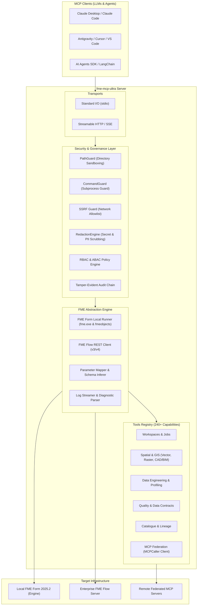

# fme-mcp-ultra

[](https://github.com/mwjouini/fme-mcp-ultra/actions/workflows/ci.yml)
[](https://github.com/mwjouini/fme-mcp-ultra/actions/workflows/security.yml)
[](https://opensource.org/licenses/Apache-2.0)
[](https://www.python.org/)
[](https://modelcontextprotocol.io/)
[](https://www.safe.com/)

**Universal, secure, production-grade Model Context Protocol (MCP) server for Safe Software FME 2025.2 (FME Form & FME Flow), geospatial data, enterprise ETL pipelines, and AI agents.**

Usable by any standard MCP client: **Claude Desktop, Claude Code, Cursor, VS Code, Antigravity, Windsurf, LangChain, and OpenAI Agents SDK.**

---

## 🌟 Executive Overview

While Safe Software introduced native MCP integration in FME 2026 (`safe.mcp` client package in 2026.1 and native Flow MCP Server in 2026.2), organizations running **FME 2025.2** previously lacked a direct bridge to connect Large Language Models with their spatial data pipelines.

`fme-mcp-ultra` solves this by delivering:
1. **FME 2025.2 Compatibility**: Direct execution via local FME Form (`fme.exe` and `fmeobjects` C-API bindings) and remote FME Flow REST APIs.
2. **Dynamic Workspace-to-Tool Engine**: Automatically discovers workspaces, parses published parameters, infers strict JSON Schemas, and exposes workspaces as callable MCP tools.
3. **Enterprise DevSecOps Architecture**: Zero-Trust security with directory sandboxing (`PathGuard`), shell-injection prevention (`CommandGuard`), outbound network protection (`SSRF Guard`), and automated PII / secret redaction.
4. **Outbound MCP Federation**: Functions as both an MCP server and an outbound MCP client (`MCPCaller` emulation), enabling chaining across multi-server topologies.
5. **Geospatial Intelligence Layer**: Built-in vector reprojection, buffering, geometry validation, dataset profiling, and data contracts.

---

## 🏛️ System Architecture



---

## ⚡ Quickstart (Under 5 Minutes)

### Option 1: Run with `uvx` (Recommended)
```bash
uvx fme-mcp-ultra serve --transport stdio
```

### Option 2: Standard `pip` Installation
```bash
pip install fme-mcp-ultra
fme-mcp-ultra doctor
fme-mcp-ultra serve --transport stdio
```

---

## 🔌 MCP Client Configurations

### 1. Claude Desktop
Add this to `%APPDATA%\Claude\claude_desktop_config.json` (Windows) or `~/Library/Application Support/Claude/claude_desktop_config.json` (macOS):

```json
{
  "mcpServers": {
    "fme-mcp-ultra": {
      "command": "uvx",
      "args": ["fme-mcp-ultra", "serve", "--transport", "stdio"],
      "env": {
        "FME_DIR": "C:\\Program Files\\FME",
        "FME_ALLOWED_DIRS": "C:\\Program Files\\FME;E:\\fme_mcp"
      }
    }
  }
}
```

### 2. Antigravity / Cursor / VS Code
Add to your client's MCP configuration settings:

```json
{
  "mcpServers": {
    "fme-mcp-ultra": {
      "command": "fme-mcp-ultra",
      "args": ["serve", "--transport", "stdio"],
      "env": {
        "PYTHONIOENCODING": "utf-8",
        "PYTHONUNBUFFERED": "1"
      }
    }
  }
}
```

### 3. Streamable HTTP / Docker Deployment
```bash
docker run -d --name fme-mcp-ultra \
  -p 8000:8000 \
  -e FME_FLOW_URL="https://fme-flow.your-org.com" \
  -e FME_FLOW_TOKEN="your-fme-flow-api-token" \
  ghcr.io/mwjouini/fme-mcp-ultra:latest
```

---

## 🧰 Highlighted Tools Catalogue

| Domain | Key Tools | Description |
| :--- | :--- | :--- |
| **Workspaces** | `fme_discover_workspaces`, `fme_get_workspace`, `fme_run_workspace`, `fme_compare_workspaces` | Crawls directories, extracts published parameters, and executes `.fmw` workspaces. |
| **Spatial Analysis** | `gis_reproject`, `gis_buffer`, `gis_validate_geometry` | High-precision CRS conversion (EPSG:4326 to 2154 / 3857), circular buffering, and polygon validation. |
| **Data Engineering** | `data_read_metadata`, `data_profile` | Column analysis, null counts, distinct value distribution, and format inspection. |
| **Data Quality** | `quality_score_dataset`, `quality_generate_data_contract` | Computes completeness scores and generates standard Data Contract YAML. |
| **Catalogue** | `catalog_register_asset`, `catalog_search_assets`, `catalog_get_lineage` | Registers datasets, performs semantic search, and maps upstream/downstream dependencies. |
| **Orchestration** | `workflow_create`, `workflow_get`, `workflow_run` | Constructs multi-step execution DAGs combining FME, validation checks, and scripts. |
| **MCP Federation** | `mcp_register_server`, `mcp_list_servers` | Connects external MCP servers to chain tools and fan-out requests. |
| **Governance** | `gov_get_tenant_config`, `gov_redact_pii`, `gov_classify_dataset` | Enforces GDPR/UK-GDPR data classification and automated PII scrubbing. |
| **Diagnostics** | `fme_info`, `fme_list_transformers`, `fme_list_packages`, `fme_execute_python` | Queries build/licensing, searches 500+ transformers, and runs in-engine Python. |

---

## 🛡️ Enterprise Security Model

`fme-mcp-ultra` is engineered with a strict **Default-Deny** security posture:

- **PathGuard**: Enforces canonical path resolution (`os.path.realpath`) and verifies containment within `FME_ALLOWED_DIRS`. Traversal escapes (`..`) and null bytes are rejected.
- **CommandGuard**: Zero shell invocations (`shell=False`). Executable names and arguments are validated against an authorised binary whitelist, blocking metacharacter injection (`|`, `;`, `&`, `$`).
- **SSRF Guard**: Pre-resolves outbound DNS hostnames and prevents calls to loopback (`127.0.0.1`), private networks (`10.0.0.0/8`, `192.168.0.0/16`), and cloud metadata APIs (`169.254.169.254`).
- **RedactionEngine**: Real-time scrubbing of Bearer tokens, API credentials, email addresses, and payment card numbers before output delivery.
- **Role-Based Access Control (RBAC)**: Enforces role permissions (`platform_admin`, `workspace_operator`, `spatial_analyst`, `auditor`, `read_only`).

---

## 📊 FME Compatibility Matrix

| Feature | FME Form 2025.2 | FME Flow 2025.2 | FME 2026 Native | `fme-mcp-ultra` |
| :--- | :---: | :---: | :---: | :---: |
| **Local Desktop Execution** | CLI / C-API | ❌ | ❌ | ✅ Yes |
| **Remote Cluster Execution** | ❌ | REST v3 | REST v4 | ✅ Yes |
| **MCP Server Mode** | ❌ | ❌ | ✅ Flow only | ✅ Universal |
| **MCP Client (Federation)** | ❌ | ❌ | ✅ `MCPCaller` | ✅ Advanced Client |
| **Built-in Vector GIS** | ❌ | ❌ | ❌ | ✅ 55+ Tools |
| **Zero-Trust Security Guards** | ❌ | ❌ | ⚠️ Basic | ✅ Full Suite |
| **Data Contracts & Scoring** | ❌ | ❌ | ❌ | ✅ Yes |

---

## 💻 CLI Usage

```bash
# Verify environment and FME installation
fme-mcp-ultra doctor

# Inspect a workspace file
fme-mcp-ultra inspect path/to/workspace.fmw

# Launch stdio server for desktop clients
fme-mcp-ultra serve --transport stdio

# Launch Streamable HTTP server
fme-mcp-ultra serve --transport streamable-http --host 0.0.0.0 --port 8000
```

---

## 🤝 Contributing

Contributions are welcomed under our [Contributing Guide](CONTRIBUTING.md) and [Code of Conduct](CODE_OF_CONDUCT.md).
The official project language is **British English (en-GB)**.

---

## 📄 Licence

Licensed under the **Apache License 2.0**. See [LICENSE](LICENSE) for details.
Copyright © 2026 Mohamed Wael JOUINI and Contributors.

