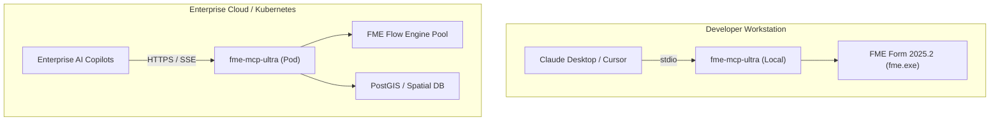

# Deployment Overview

`fme-mcp-ultra` can be deployed across several topologies depending on your operational requirements:

1. **Local Desktop Stdio Mode**: Directly coupled with AI clients like Claude Desktop, Cursor, or Antigravity on a workstation with local FME Form installed.
2. **Containerised Streamable HTTP Server**: Deployed via Docker or Kubernetes adjacent to an enterprise FME Flow cluster or spatial database.
3. **Hybrid Gateway**: Operating in front of both local developer workstations and shared cloud FME Flow instances.

---

## Deployment Architectures

